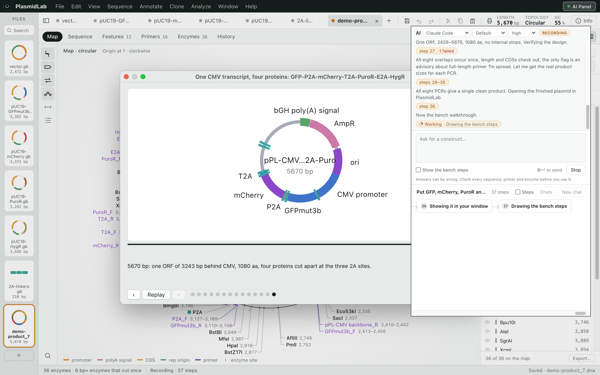
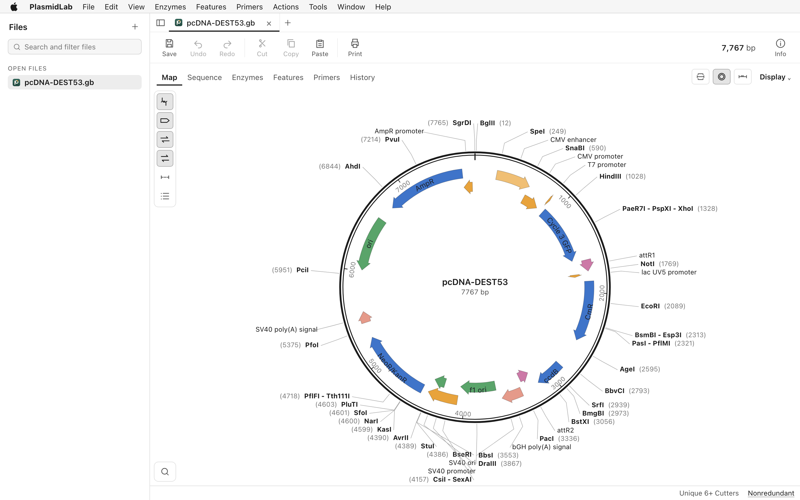

# PlasmidLab

A plasmid map and sequence editor for Mac and Windows, with an agent that plans cloning on your own
files. Free to download at [plasmidlab.com](https://plasmidlab.com/).

[Download for Mac](https://github.com/plasmidlab/plasmidlab/releases/download/v0.2.5/PlasmidLab-Mac.dmg)
· [Download for Windows](https://github.com/plasmidlab/plasmidlab/releases/download/v0.2.5/PlasmidLab-Windows.exe)
· [All releases](https://github.com/plasmidlab/plasmidlab/releases)



## What it does

- Opens `.dna`, GenBank, FASTA, EMBL and ApE files, and `.ab1` and `.scf` sequencing traces.
- Draws the plasmid map, the sequence, the features, the primers and the cut sites in one window.
- Simulates restriction, Gibson, Golden Gate, Gateway and TA/TOPO cloning, PCR, mutagenesis and gels.
- Finds restriction sites from the REBASE enzyme list, translates in six frames and designs primers.
- Takes a request in plain words, such as moving a gene from one plasmid into another, calls its own
  cloning functions on your files, and shows every step, every primer and the product before you order.
  It runs on a Claude, Codex or Grok plan you already have, or on a free trial of ten runs.



## Free tools that run in the browser

No account, nothing to install, and the sequence stays in the page.

- [Restriction site finder](https://plasmidlab.com/tools/restriction-sites/)
- [Restriction enzyme list](https://plasmidlab.com/tools/restriction-enzymes/)
- [Virtual agarose gel](https://plasmidlab.com/tools/virtual-gel/)
- [DNA molarity and ligation calculator](https://plasmidlab.com/tools/dna-molarity/)
- [GC content and primer Tm](https://plasmidlab.com/tools/gc-content/)
- [Translate DNA and find ORFs](https://plasmidlab.com/tools/translate/)
- [Reverse complement](https://plasmidlab.com/tools/reverse-complement/)

## Guides

- [Open .dna and GenBank files](https://plasmidlab.com/guides/open-dna-genbank/)
- [Open a GenBank file](https://plasmidlab.com/guides/open-genbank-file/)
- [View a plasmid map](https://plasmidlab.com/guides/plasmid-map/)
- [Design a Gibson assembly](https://plasmidlab.com/guides/gibson-assembly/)
- [Golden Gate assembly](https://plasmidlab.com/guides/golden-gate-assembly/)
- [Restriction cloning](https://plasmidlab.com/guides/restriction-cloning/)
- [Gateway cloning](https://plasmidlab.com/guides/gateway-cloning/)
- [Design PCR primers](https://plasmidlab.com/guides/pcr-primer-design/)
- [All guides](https://plasmidlab.com/guides/)

### 한국어

- [PlasmidLab 소개](https://plasmidlab.com/ko/)
- [SnapGene .dna 파일 열기](https://plasmidlab.com/ko/guides/dna-file-open/)
- [Gibson 프라이머 설계](https://plasmidlab.com/ko/guides/gibson-primer/)
- [한국어 가이드 전체](https://plasmidlab.com/ko/guides/)

## This repository

This repository holds the website and the release downloads. The app source lives elsewhere.

The app is licensed under the [Terms of Use](https://plasmidlab.com/terms/). Site code and media: see
[LICENSE.md](LICENSE.md).

### IndexNow

The key is `6315c8446dfbf8ad0d922177aa3e37b0`, served at
https://plasmidlab.com/6315c8446dfbf8ad0d922177aa3e37b0.txt (the file holds only the key). After a push
that changes pages, tell Bing, Naver, Yandex and the other IndexNow engines, listing the changed URLs:

```
curl -s -X POST https://api.indexnow.org/indexnow -H 'Content-Type: application/json; charset=utf-8' -d '{"host":"plasmidlab.com","key":"6315c8446dfbf8ad0d922177aa3e37b0","keyLocation":"https://plasmidlab.com/6315c8446dfbf8ad0d922177aa3e37b0.txt","urlList":["https://plasmidlab.com/","https://plasmidlab.com/tools/translate/"]}'
```

A 200 or 202 reply means it was accepted. Google does not use IndexNow; use Search Console and the
sitemap for Google.

---

PlasmidLab is for research use only, and the free AI trial is for people aged 18 or older. Gibson
Assembly, Gateway, TOPO, SnapGene, Claude, Codex and Grok are trademarks of their owners. PlasmidLab is
not affiliated with or endorsed by them.
